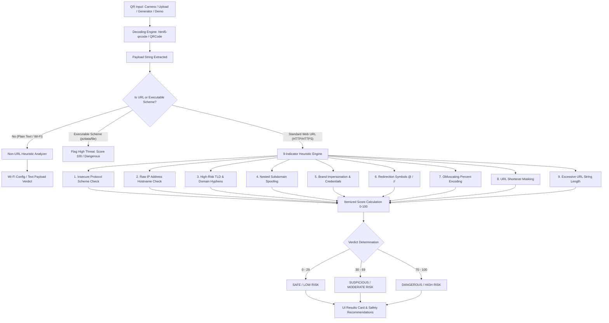

# 🛡️ QR Guide 2 — Transparent Heuristic QR Security & Risk Scoring System

[](https://github.com/shrutirajput745/qr-guard_02/actions)
[](https://vercel.com)
[](https://nodejs.org)
[](LICENSE)
[](#)

> **QR Guide 2** is a production-ready, client-and-server QR security analysis system engineered to combat **Quishing** (QR code phishing). It evaluates decoded payloads across **9 transparent, itemized heuristic security rules**, assigns an explainable risk score (0–100), categorizes threats into a 3-tier verdict, and provides actionable defensive guidance before a user visits an untrusted destination.

---

## 📑 Table of Contents

- [Key Features](#-key-features)
- [System Architecture](#-system-architecture)
- [Transparent Heuristic Risk Engine](#-transparent-heuristic-risk-engine)
- [Directory Structure](#-directory-structure)
- [API Reference](#-api-reference)
- [Getting Started](#-getting-started)
- [Testing & Quality Assurance](#-testing--quality-assurance)
- [Production & Vercel Deployment](#-production--vercel-deployment)
- [CI/CD Automation Pipeline](#-cicd-automation-pipeline)
- [Team Contribution & Workflow](#-team-contribution--workflow)

---

## 🌟 Key Features

- **Live Camera Scanner & Drag-and-Drop Image Parser**: Real-time webcam scanning via `html5-qrcode` and drag-and-drop file upload with error handling for blurred or unreadable barcodes.
- **Interactive QR Code Generator**: Generates custom QR matrix codes on HTML5 canvas and immediately analyzes their structural risk.
- **Pre-Loaded Educational Demo Cases**: Instant one-click testing of Safe (Wikipedia), Suspicious (Shorteners, .TOP TLDs), Dangerous (IP Host, Impersonation), and Non-URL payloads (Wi-Fi, Contact cards).
- **Universal Heuristic Analyzer (UMD)**: Identical analysis engine shared across the frontend browser, local Express server, and Vercel cloud serverless functions.
- **XSS & Execution Defense**: Automatic HTML sanitization of reflected payload fields and defensive gating preventing automatic execution of script schemes (`javascript:`, `data:`, `file:`).
- **Dark / Light Theme Toggle**: Dynamic theme switching with persistent local storage caching.

---

## 🏛️ System Architecture



---

## 🔬 Transparent Heuristic Risk Engine

Every analysis assigns itemized points that are displayed directly in the user interface:

| # | Indicator Check | Condition | Risk Points | Severity |
| :---: | :--- | :--- | :---: | :---: |
| **1** | **Dangerous Scheme** | `javascript:`, `data:`, `file:`, `vbscript:` | **+100 pts** | High |
| **1** | **Insecure Connection** | `http://` instead of `https://` | **+20 pts** | Medium |
| **2** | **Raw IP Hostname** | Hostname is an IPv4 or IPv6 address | **+35 pts** | High |
| **3** | **High-Risk TLD** | Top-level domains associated with phishing (`.top`, `.xyz`, etc.) | **+25 pts** | Medium |
| **3** | **Hyphen-Heavy Domain** | 3 or more hyphens in domain labels | **+15 pts** | Medium |
| **4** | **Excessive Subdomains** | 2 or more nested subdomains | **+25 pts** | High |
| **5** | **Brand Impersonation** | Mimicking known brands (PayPal, Apple, Google, Microsoft, Banks) on unverified domains | **+30 pts** | High |
| **5** | **Sensitive Action Trigger** | Action keywords (`login`, `signin`, `claim`, `prize`) on HTTP or high-risk hosts | **+30 pts** | High |
| **6** | **Redirection Symbol** | Presence of `@` sign in URL | **+40 pts** | High |
| **7** | **Heavy Encoding** | More than 3 percent-encoded (`%xx`) characters | **+15 pts** | Medium |
| **7** | **Open-Redirect Traversal** | Consecutive slashes (`//`) in path | **+15 pts** | Medium |
| **8** | **URL Shortener** | Known masking services (`bit.ly`, `tinyurl.com`, `t.co`, etc.) | **+15 pts** | Medium |
| **9** | **Excessive URL Length** | Total string exceeds 110 characters | **+10 pts** | Low |

### 3-Tier Risk Verdicts
- **🟢 Safe (0–29 Points)**: Clean structure with standard encryption and reputable domain format.
- **🟡 Suspicious (30–69 Points)**: Moderate risk triggers (shorteners, unencrypted HTTP, high-risk TLDs). Users are urged to verify destination before interaction.
- **🔴 Dangerous (70–100 Points)**: Severe phishing indicators (brand spoofing, `@` trick, IP hosts, script injection). Direct execution is blocked.

---

## 📁 Directory Structure

```
qr-guard_02/
├── .github/
│   └── workflows/
│       └── ci.yml               # Multi-OS CI/CD pipeline (Node 18/20/22, testing, building)
├── api/
│   ├── analyze.js               # Vercel Serverless Function: POST /api/analyze
│   └── health.js                # Vercel Serverless Function: GET /api/health
├── public/
│   ├── css/
│   │   └── style.css            # Complete design system, dark/light themes, animations
│   ├── js/
│   │   ├── analyzer.js          # Heuristic analysis engine (UMD module)
│   │   ├── app.js               # Main UI controller & DOM event handling
│   │   ├── samples.js           # Demo test suites and custom QR generator
│   │   └── scanner.js           # Camera barcode reader & drag-and-drop file parser
│   └── index.html               # Main responsive single-page application
├── scripts/
│   └── build.js                 # Production asset and AST syntax build validation
├── tests/
│   ├── unit-tests.js            # 32 unit tests verifying heuristic rules
│   ├── api-tests.js             # 8 API and serverless integration tests
│   ├── test-api.js              # Integration test script for HTTP clients
│   └── run-all-tests.js         # Master test runner (invoked by npm test)
├── .gitignore                   # Ignores dependencies, local logs, and OS caches
├── .vercelignore                # Prevents test suites and docs from deployment bundle
├── package.json                 # Dependency manifest, scripts, and Node engines
├── package-lock.json            # Deterministic package lock
├── server.js                    # Express application server mounting shared API handlers
├── vercel.json                  # Vercel cloud configuration, rewrites, and security headers
└── README.md                    # Project documentation
```

---

## 📡 API Reference

### 1. Security Heuristic Analysis
- **URL**: `/api/analyze`
- **Method**: `POST`
- **Content-Type**: `application/json`

#### Request Payload
```json
{
  "qrData": "http://free-reward-claim.top/login"
}
```

#### Response (200 OK)
```json
{
  "input": "http://free-reward-claim.top/login",
  "isUrl": true,
  "score": 75,
  "status": "Dangerous",
  "issues": [
    {
      "severity": "medium",
      "category": "Protocol Security",
      "title": "Unencrypted HTTP Protocol",
      "points": 20,
      "message": "HTTP transmits data in plain text without SSL/TLS encryption, exposing traffic to interception."
    },
    {
      "severity": "medium",
      "category": "Domain Pattern",
      "title": "High-Risk TLD (.top)",
      "points": 25,
      "message": "Top-level domain (.top) is statistically associated with higher rates of phishing and spam registrations."
    },
    {
      "severity": "high",
      "category": "Phishing Keywords",
      "title": "Sensitive Credential / Reward Keywords",
      "points": 30,
      "message": "URL contains sensitive action keywords [login, claim, free-reward] on an insecure or unverified host (free-reward-claim.top)."
    }
  ],
  "scoreBreakdown": [
    { "factor": "Unencrypted HTTP Connection", "points": 20 },
    { "factor": "High-Risk TLD (.top)", "points": 25 },
    { "factor": "Sensitive Action Keywords [login, claim, free-reward]", "points": 30 }
  ],
  "highlights": [
    {
      "category": "Host Identity",
      "title": "Standard Domain Name",
      "message": "Resolves via standard domain name (free-reward-claim.top)."
    }
  ],
  "explanation": "Score of 75/100 calculated from detected indicators: Unencrypted HTTP Connection (+20 pts), High-Risk TLD (.top) (+25 pts), Sensitive Action Keywords [login, claim, free-reward] (+30 pts).",
  "advice": "DANGER: High risk score detected. DO NOT visit this URL or enter credentials. Verify the link with the sender through an independent channel.",
  "metrics": {
    "protocol": "HTTP",
    "hostType": "Domain Host",
    "tld": ".top",
    "pointsAssigned": 75
  }
}
```

### 2. Health & Status
- **URL**: `/api/health`
- **Method**: `GET`

#### Response (200 OK)
```json
{
  "status": "ok",
  "timestamp": "2026-10-16T03:00:00.000Z",
  "service": "QR Guide 2 - Security Engine",
  "environment": "vercel-production",
  "version": "2.0.0"
}
```

---

## 🚀 Getting Started

### Prerequisites
- **Node.js**: `v18.0.0` or higher
- **npm**: `v9.0.0` or higher
- **Git**

### 1. Clone & Install
```bash
git clone https://github.com/shrutirajput745/qr-guard_02.git
cd qr-guard_02
npm install
```

### 2. Run Locally
```bash
# Start local Express server
npm start

# Or run with hot-reload in development
npm run dev
```
Open **`http://localhost:3000`** in your browser.

---

## 🧪 Testing & Quality Assurance

The codebase includes comprehensive automated tests covering boundary cases, false-positive protection, and API endpoints:

```bash
# Execute master automated test suite (32 unit tests + 8 API/Serverless tests)
npm test
```

### Test Coverage Highlights
- **Boundary Verification**: Null, empty, whitespace strings receive 100-point danger ratings.
- **False-Positive Prevention**: Confirms that domains like `microsoft.com`, `target.com`, `reddit.com`, and `pinterest.com` are **not** falsely flagged as `t.co` shorteners.
- **Legitimate Login Protection**: Confirms that legitimate HTTPS destinations (e.g., `accounts.google.com/signin`) pass with score 0 (Safe).
- **Executable Scheme Defense**: Confirms that `javascript:`, `data:`, and `file:` schemes trigger immediate 100-point security stops.
- **Serverless API Integration**: Verifies CORS preflight, HTTP methods, and status codes.

---

## 🌐 Production & Vercel Deployment

This project is configured for seamless deployment on [Vercel](https://vercel.com):

### Automatic Vercel GitHub Integration (Recommended)
1. Push your repository to GitHub.
2. In the [Vercel Dashboard](https://vercel.com/new), select **Add New Project** and import `qr-guard_02`.
3. Vercel automatically detects `vercel.json` and `package.json`, runs `npm run build`, and launches your deployment.

### Manual Vercel CLI Deployment
```bash
npx vercel --prod
```

### Production Security Headers
Every response served by Vercel automatically carries enterprise security headers defined in `vercel.json`:
- `X-Content-Type-Options: nosniff`
- `X-Frame-Options: DENY`
- `X-XSS-Protection: 1; mode=block`
- `Referrer-Policy: strict-origin-when-cross-origin`
- `Permissions-Policy: camera=*`

---

## 🔄 CI/CD Automation Pipeline

Automated checks run on every push and pull request via [GitHub Actions](.github/workflows/ci.yml):

1. **Test Matrix**:
   - Node.js versions: `18.x`, `20.x`, `22.x`
   - Operating Systems: `ubuntu-latest`, `windows-latest`
   - Command: `npm test`
2. **Build Validation**:
   - Executes `npm run build` via `scripts/build.js`.
   - Validates AST syntax across all JavaScript files.
   - Asserts all production distribution files exist.
3. **Continuous Deployment**:
   - When repository secrets (`VERCEL_TOKEN`, `VERCEL_ORG_ID`, `VERCEL_PROJECT_ID`) are configured, main branch merges automatically deploy to Vercel production.

---

## 👥 Team Contribution & Workflow

1. **Create a Feature Branch**:
   ```bash
   git checkout -b feature/your-feature-name
   ```
2. **Make Changes & Test Locally**:
   ```bash
   npm test
   npm run build
   ```
3. **Commit with Descriptive Message**:
   ```bash
   git commit -m "feat(analyzer): add new heuristic rule for punycode domains"
   ```
4. **Push & Open a Pull Request**:
   ```bash
   git push origin feature/your-feature-name
   ```
   Ensure all GitHub Actions checks pass before requesting reviews.

---

## 📄 License

This project is licensed under the [MIT License](LICENSE).
